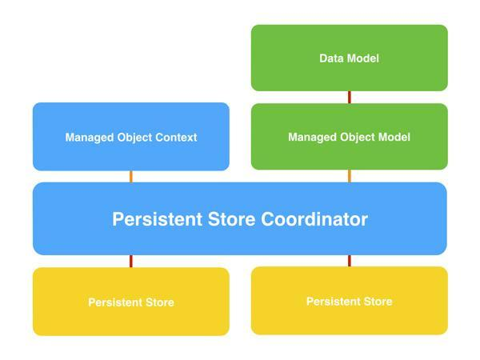
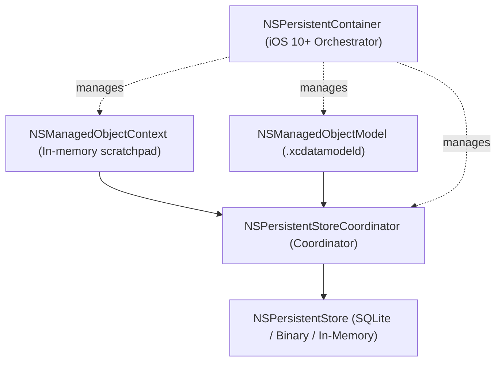

[← Back to My iOS Handbook](./My%20iOS%20Handbook.md) | [‹ Previous: 4. iOS SDK & UIKit (Fundamentals & Advanced)](./04-iOS-SDK-and-UIKit.md) | [Next: 6. Concurrency & Multithreading (GCD, OperationQueue, Swift Concurrency) ›](./06-Concurrency-GCD-Operation-AsyncAwait.md)

---

# 5. Data Persistence & iOS File System

## 5.1. iOS App Sandbox Directory Structure
Each iOS app operates inside an isolated Sandbox environment with three main directories:

| Directory | Purpose | iCloud / iTunes Backup |
| :--- | :--- | :---: |
| **`Documents/`** | Stores **user-generated content** or files you want exposed/shared with the user (e.g., notes, downloaded documents). | **Yes** |
| **`Library/`** | Stores app-internal support files **not exposed directly to the user** (databases, preferences). Key subdirectories: `Application Support/` (backed up) and `Caches/` (recreatable network caches). | **Yes** *(except `Library/Caches`)* |
| **`tmp/`** | Stores **temporary files** that do not need to persist between app launches. The system may purge this directory when the app is not running. | **No** |

- **`Path` vs. `URL`:** A `Path` is a plain string representing a filesystem location (e.g., `"/var/.../file.txt"`), whereas `Foundation.URL` is a structured object representing local (`file://`) or remote (`https://`) resources, supporting path validation, extension parsing, and Apple APIs (`FileManager`, `URLSession`).

## 5.2. CRUD & Storage Options (DBMS) on iOS
- **CRUD:** Stands for the four basic data operations: **C**reate, **R**ead, **U**pdate, **D**elete.
- **Common iOS Persistence Options & DBMS:**
  - **`UserDefaults`:** Lightweight Key-Value store for user preferences, flags, and small UI state. Never use for sensitive or large data.
  - **`Keychain`:** Hardware-encrypted system storage for passwords, Access Tokens, Refresh Tokens, and private keys. Can optionally persist across app reinstalls.
  - **`SQLite`:** Lightweight embedded Relational DBMS (RDBMS) requiring no server, stored as a single `.sqlite` file and queried via SQL.
  - **`Core Data`:** Apple's object graph management and persistence framework (typically backed by SQLite).
  - **`Realm`:** Fast, open-source cross-platform object database using a custom C++ storage engine.

## 5.3. Core Data Stack & SQL Comparison
- **What is Core Data?** An Apple framework for managing the model layer (object graph), change tracking, undo/redo, relationships, and persistence. **Important:** Core Data is **not** a raw SQL database—it is an object-graph framework that persists objects to disk (usually SQLite).
- **Core Data Stack Components:**
  1. **`NSManagedObjectModel`:** Represents your app's data schema (`*.xcdatamodeld`), defining Entities, Attributes, and Relationships.
  2. **`NSManagedObject`:** Represents a single persisted object/record (analogous to a row in a database table), backed by `NSEntityDescription`.
  3. **`NSManagedObjectContext`:** An **in-memory scratchpad** managing the lifecycle of created or fetched managed objects. Changes stay in memory until `context.save()` persists them to disk. (Complex apps may use separate main and background contexts).
  4. **`NSPersistentStoreCoordinator`:** Coordinates communication between `NSManagedObjectContext`, `NSManagedObjectModel`, and `NSPersistentStore`.
  5. **`NSPersistentStore`:** The underlying storage layer (SQLite, Binary, or In-Memory) that executes actual reads/writes and generates SQL when backed by SQLite.
  6. **`NSPersistentContainer` (iOS 10+):** High-level container that initializes and orchestrates all four Core Data stack classes cleanly out of the box.

- **SQL (SQLite) vs. Core Data:**

| Aspect | SQL / SQLite | Core Data |
| :--- | :--- | :--- |
| **Constraints & Querying** | Strict table/column constraints (Primary Key, Foreign Key, NOT NULL); manipulated via SQL queries. | Object-graph model; constraints and relationships defined in `.xcdatamodeld`. |
| **Execution Model** | Operates directly on database files stored on **disk**. | Loads objects into **RAM** via a Context for manipulation, then persists on `save()`. |
| **Bulk / Schema Operations** | Can `DROP`, `ALTER`, or bulk-update/delete directly on disk without loading records into memory. | Traditionally loads objects into memory to modify/delete (though `NSBatchUpdateRequest`/`NSBatchDeleteRequest` help bypass memory for bulk operations). |
| **Performance Profile** | Faster and lower memory overhead for massive datasets and bulk mutations. | Fast for cached in-memory object traversal, though saving very large batches can be slower. |

## 5.4. Realm Database
- **What is Realm?** An open-source, mobile-first object database (iOS, Android, etc.) built on its own C++ engine rather than SQLite.
- **Pros:** Less boilerplate than Core Data, fast read/write performance, **zero-copy** memory-mapped architecture, and **auto-updating objects** with fine-grained change notifications.
- **Cons:** Adds binary size (~several MB), introduces a third-party SDK dependency, and `Object` instances are thread-confined (must pass `ThreadSafeReference` or primary keys across threads).

---

[← Back to My iOS Handbook](./My%20iOS%20Handbook.md) | [‹ Previous: 4. iOS SDK & UIKit (Fundamentals & Advanced)](./04-iOS-SDK-and-UIKit.md) | [Next: 6. Concurrency & Multithreading (GCD, OperationQueue, Swift Concurrency) ›](./06-Concurrency-GCD-Operation-AsyncAwait.md)
