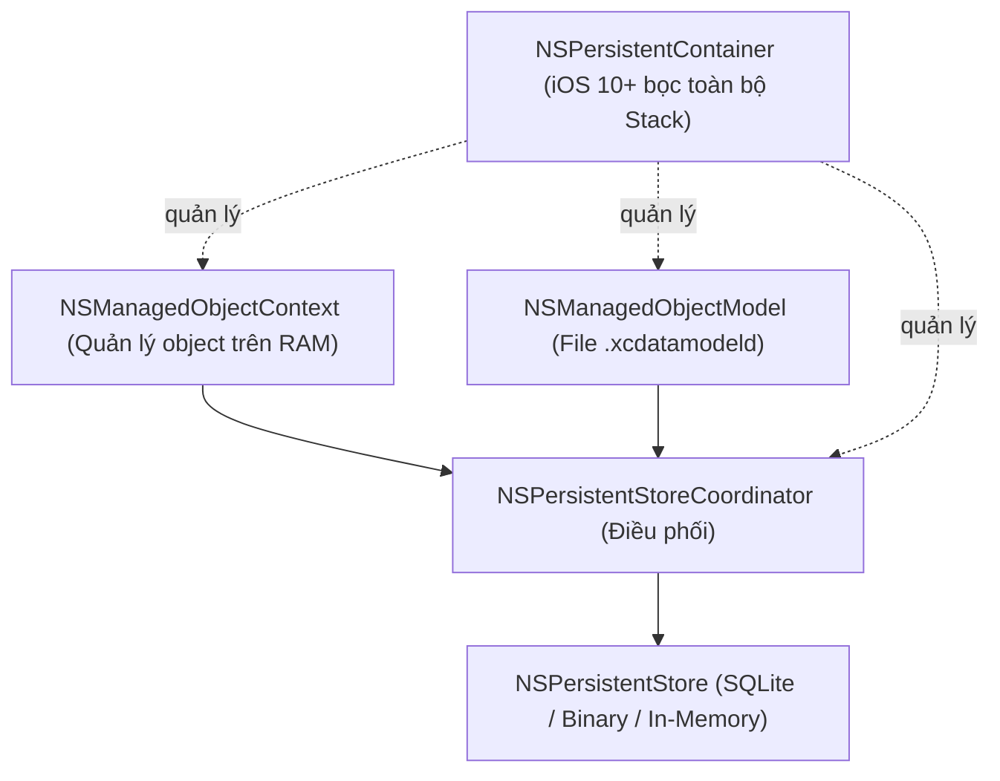

[← Mục lục My iOS Handbook](./My%20iOS%20Handbook.md) | [‹ Bài trước: 4. Kiến thức iOS SDK & UIKit cơ bản & nâng cao](./04-iOS-SDK-va-UIKit.md) | [Bài tiếp: 6. Đa luồng & Bất đồng bộ (Concurrency: GCD, Operation, Swift Concurrency) ›](./06-Concurrency-GCD-Operation-AsyncAwait.md)

---

# 5. Lưu trữ dữ liệu (Persistence) & Hệ thống File iOS

## 5.1. Cấu trúc thư mục Sandbox của ứng dụng iOS
Mỗi ứng dụng iOS chạy trong một vùng lưu trữ cô lập (*Sandbox*) gồm các thư mục chính:

| Thư mục | Mục đích sử dụng | Backup iCloud / iTunes |
| :--- | :--- | :---: |
| **`Documents/`** | Lưu dữ liệu **do người dùng tạo ra** hoặc file cần hiển thị/chia sẻ với người dùng (ví dụ: file ghi chú, tài liệu tải về theo yêu cầu người dùng). | **Có** |
| **`Library/`** | Lưu các file dữ liệu nội bộ của app **không muốn lộ trực tiếp cho người dùng** (cơ sở dữ liệu, cấu hình). Gồm 2 thư mục con hay dùng: `Application Support/` (có backup) và `Caches/` (dữ liệu cache tải về từ mạng). | **Có** *(trừ `Library/Caches`)* |
| **`tmp/`** | Lưu các **file tạm thời** không cần tồn tại qua các lần khởi chạy lại app. Hệ thống có thể tự động xóa thư mục này khi app không chạy hoặc thiếu dung lượng. | **Không** |

- **Phân biệt `Path` vs `URL`:** `Path` là chuỗi ký tự biểu diễn đường dẫn file trong hệ thống file (ví dụ `"/var/.../file.txt"`), còn `URL` (`Foundation.URL`) là đối tượng chuẩn hóa đại diện cho tài nguyên (file cục bộ `file://` hoặc địa chỉ mạng `https://`), giúp kiểm tra tính hợp lệ, tách phần mở rộng và tương thích tốt với các API của Apple (`FileManager`, `URLSession`).

## 5.2. CRUD & Các lựa chọn Lưu trữ Dữ liệu (DBMS) trên iOS
- **CRUD:** Là viết tắt của 4 thao tác cơ bản quản lý dữ liệu: **C**reate (Tạo mới), **R**ead (Đọc/Truy vấn), **U**pdate (Cập nhật), **D**elete (Xóa).
- **Tổng quan các hệ quản trị / công cụ lưu trữ trên iOS:**
  - **`UserDefaults`:** Lưu cặp Key-Value nhẹ (cài đặt, cờ boolean, trạng thái UI). Không dùng cho dữ liệu lớn hay thông tin nhạy cảm.
  - **`Keychain`:** Kho lưu trữ mã hóa bảo mật cấp hệ thống, chuyên dùng để lưu mật khẩu, Access Token, Refresh Token, Private Key. Dữ liệu vẫn có thể tồn tại ngay cả khi gỡ app cài lại (tùy cấu hình).
  - **`SQLite`:** Hệ quản trị CSDL quan hệ (RDBMS) dạng nhúng cực nhẹ, không cần server, lưu thành 1 file `.sqlite` duy nhất, thao tác trực tiếp bằng câu lệnh SQL.
  - **`Core Data`:** Framework quản lý đồ thị đối tượng (Object Graph) của Apple (lớp nền thường dùng SQLite).
  - **`Realm`:** Cơ sở dữ liệu hướng đối tượng mã nguồn mở (hỗ trợ đa nền tảng iOS, Android...), hiệu năng cao và API trực quan.

## 5.3. Core Data
- **Core Data là gì?** Là một framework chính chủ Apple dùng để quản lý tầng Model (Object Graph Management) và lưu trữ dữ liệu bền vững (*Persistence*). **Lưu ý quan trọng:** Core Data **không phải là một hệ quản trị CSDL SQL thuần túy**; nó là một framework quản lý đối tượng trên bộ nhớ, hỗ trợ save, track thay đổi, undo/redo, relationship, validation và lưu xuống ổ cứng (mặc định dùng SQLite).
- **Các thành phần trong Core Data Stack:**
  1. **`NSManagedObjectModel`:** Đại diện cho lược đồ (schema) của dữ liệu trong project — tương ứng trực quan với file `*.xcdatamodeld` (chứa các Entity, Attributes và Relationships).
  2. **`NSManagedObject`:** Đại diện cho một bản ghi/đối tượng cụ thể trong Core Data (tương tự 1 hàng trong bảng DB), liên kết với `NSEntityDescription`.
  3. **`NSManagedObjectContext`:** Đóng vai trò như một *"vùng nháp trên RAM"* (in-memory scratchpad) quản lý vòng đời các `NSManagedObject` được tạo hoặc fetch lên. Mọi thay đổi trên object chỉ thực sự ghi xuống ổ cứng khi gọi `context.save()`. (App phức tạp có thể dùng nhiều context, ví dụ 1 main context cho UI và 1 background context để import dữ liệu).
  4. **`NSPersistentStoreCoordinator`:** Điều phối trung gian giữa `NSManagedObjectContext`, `NSManagedObjectModel` và `NSPersistentStore`.
  5. **`NSPersistentStore`:** Kho lưu trữ vật lý thực tế dưới ổ cứng (SQLite, Binary, In-Memory), chuyển đổi thao tác object thành lệnh SQL để đọc/ghi dữ liệu.
  6. **`NSPersistentContainer` (từ iOS 10+):** Lớp bao đóng gói và khởi tạo sẵn cả 4 thành phần trên (`Model`, `Context`, `Coordinator`, `Store`) giúp setup Core Data cực kỳ gọn nhẹ.

- **So sánh SQL (SQLite) vs Core Data:**

| Tiêu chí | SQL / SQLite | Core Data |
| :--- | :--- | :--- |
| **Ràng buộc & Truy vấn** | Ràng buộc chặt chẽ ở mức bảng/cột (Primary Key, Foreign Key, NOT NULL...); thao tác bằng câu lệnh SQL. | Làm việc theo mô hình đối tượng (Object Graph); ràng buộc và relationship định nghĩa trong `.xcdatamodeld`. |
| **Cách thức hoạt động** | Thao tác trực tiếp với file DB trên **ổ cứng**. | Dữ liệu được load vào **Memory (RAM)** qua Context để xử lý, sau đó mới `save()` xuống ổ cứng. |
| **Cập nhật / Xóa hàng loạt** | Có thể `DROP`, `ALTER`, `UPDATE/DELETE` hàng loạt trực tiếp trên DB mà không cần load dữ liệu lên RAM. | Theo cách truyền thống cần fetch object vào RAM để sửa/xóa (dù có `NSBatchUpdateRequest`/`NSBatchDeleteRequest` để tối ưu sau này). |
| **Hiệu năng** | Truy vấn tập dữ liệu cực lớn, batch update nhanh và tốn ít RAM. | Khởi tạo/truy xuất đối tượng đã cache trên RAM nhanh, nhưng thao tác `save()` lượng lớn bản ghi có thể tốn thời gian và RAM. |

## 5.4. Realm Database
- **Realm là gì?** Là một hệ cơ sở dữ liệu hướng đối tượng mã nguồn mở (không dùng SQLite làm lõi, tự phát triển engine lưu trữ riêng bằng C++).
- **Ưu điểm:** Dễ dùng hơn Core Data (ít boilerplate), hỗ trợ đa nền tảng (iOS, Android), tốc độ đọc/ghi nhanh, hỗ trợ **Zero-Copy** (truy cập trực tiếp dữ liệu trên đĩa ánh xạ bộ nhớ mà không cần copy toàn bộ vào RAM) và **Auto-updating objects / Notifications** (tự động cập nhật khi dữ liệu thay đổi).
- **Nhược điểm:** Tăng kích thước file cài đặt app (~vài MB), phụ thuộc vào thư viện bên thứ ba (SDK Realm), và đối tượng Realm gắn chặt với thread tạo ra nó (không thể truyền trực tiếp `Object` giữa các thread khác nhau mà phải truyền qua `ThreadSafeReference` hoặc primary key).

---

[← Mục lục My iOS Handbook](./My%20iOS%20Handbook.md) | [‹ Bài trước: 4. Kiến thức iOS SDK & UIKit cơ bản & nâng cao](./04-iOS-SDK-va-UIKit.md) | [Bài tiếp: 6. Đa luồng & Bất đồng bộ (Concurrency: GCD, Operation, Swift Concurrency) ›](./06-Concurrency-GCD-Operation-AsyncAwait.md)
