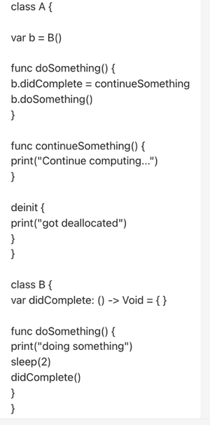
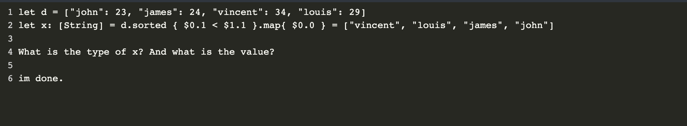

[← Back to My iOS Handbook](./My%20iOS%20Handbook.md) | [‹ Previous: 8. Networking, Security, RxSwift, Debugging & Unit Testing](./08-Networking-RxSwift-Debug-UnitTest.md)

---

# 9. Practical Exercises, Live Coding & Algorithms

## Exercise 1: "CDG Zig" (FizzBuzz Variant)
*(Source: `CDG_iOS_Questions.docx`, `Swift.docx`)*

- **Prompt:** Write a program that prints the numbers from `1` to `100`. For multiples of 3 print `"Zig"`, for multiples of 5 print `"CDG"`, and for multiples of both 3 and 5 print `"CDG Zig"` instead of the number.
- **Interview Trap:** The combined divisibility check (`i % 3 == 0 && i % 5 == 0`) **must come first** in the `if - else if` chain. Placing `i % 3 == 0` first would incorrectly print `"Zig"` for `15`, `30`, etc.

```swift
for i in 1...100 {
    if i % 3 == 0 && i % 5 == 0 {
        print("CDG Zig")
    } else if i % 3 == 0 {
        print("Zig")
    } else if i % 5 == 0 {
        print("CDG")
    } else {
        print(i)
    }
}
```

---

## Exercise 2: Most Frequent String in an Array
*(Source: `CDG_iOS_Questions.docx`, `Swift.docx`)*

- **Prompt:** Write a function that accepts an array of strings `[String]` and returns the most frequent string along with its count.
  - *Sample Input:* `["red", "yellow", "red", "green", "red"]` -> *Sample Output:* `("red", 3)`.
- **Analysis:** Count frequencies in a single pass using a `[String: Int]` dictionary ($O(n)$), then find the maximum entry with `.max(by:)`. Time Complexity: $O(n)$, Space Complexity: $O(k)$ where $k$ is the number of unique strings.

```swift
func mostFrequentString(strings: [String]) -> (String, Int)? {
    guard !strings.isEmpty else { return nil }

    var counts: [String: Int] = [:]
    for str in strings {
        counts[str, default: 0] += 1
    }

    if let mostFrequent = counts.max(by: { $0.value < $1.value }) {
        return (mostFrequent.key, mostFrequent.value)
    }
    return nil
}

let input = ["red", "yellow", "red", "green", "red"]
if let result = mostFrequentString(strings: input) {
    print(result) // ("red", 3)
}
```

---

## Exercise 3: Most Common Pair of Strings
*(Source: `CDG_iOS_Questions.docx`, `Swift.docx`)*

- **Prompt:** Write a function accepting a list of strings `[String]` that finds the most frequent pair of strings `(String, String)` and its occurrence count.
- **Analysis & Improvement over Original Snippet:**
  - The naive approach in the original notes joined strings with `"\(pair.0),\(pair.1)"` and split on `","`, which **breaks if an input string itself contains a comma**.
  - **Better Solution:** Define a `Hashable` `StringPair` struct as the dictionary key.

```swift
struct StringPair: Hashable {
    let first: String
    let second: String
}

func findMostCommonPair(strings: [String]) -> (String, String, Int)? {
    guard strings.count >= 2 else { return nil }

    var pairCounts: [StringPair: Int] = [:]
    for i in 0..<strings.count {
        for j in (i + 1)..<strings.count {
            let pair = StringPair(first: strings[i], second: strings[j])
            pairCounts[pair, default: 0] += 1
        }
    }

    guard let best = pairCounts.max(by: { $0.value < $1.value }) else {
        return nil
    }
    return (best.key.first, best.key.second, best.value)
}
```

---

## Exercise 4: N-th Fibonacci Number
*(Source: `Swift.docx`)*

- **Prompt:** Compute the $n$-th Fibonacci number ($F(0) = 0, F(1) = 1, F(n) = F(n-1) + F(n-2)$).
- **Analysis:**
  - **Approach 1 (Plain Recursion):** Clean to read, but $O(2^n)$ exponential time due to recomputing overlapping subproblems.
  - **Approach 2 (Iterative DP — Recommended in Interviews):** Runs in **$O(n)$** time and **$O(1)$** space.

```swift
// Approach 1: Plain Recursion (O(2^n))
func fibonacciRecursive(n: Int) -> Int {
    if n <= 0 { return 0 }
    if n == 1 { return 1 }
    return fibonacciRecursive(n: n - 1) + fibonacciRecursive(n: n - 2)
}

// Approach 2: Iterative Optimized (Time: O(n), Space: O(1))
func fibonacciIterative(n: Int) -> Int {
    guard n > 0 else { return 0 }
    if n == 1 { return 1 }

    var prev = 0
    var curr = 1
    for _ in 2...n {
        let next = prev + curr
        prev = curr
        curr = next
    }
    return curr
}

print(fibonacciIterative(n: 10)) // 55
```

---

## Exercise 5: Key Combo Matching (`SpecialActions.matchKeyCombo`)
*(Source: `Swift.docx` — Test 1)*

- **Prompt:** Implement `SpecialActions.matchKeyCombo(sequence: String) -> Bool` to check (case-insensitively) whether `"QEE"` and `"ZCC"` occur the exact same number of times in `sequence`.

```swift
public class SpecialActions {
    public static func matchKeyCombo(sequence: String) -> Bool {
        let lowercasedSequence = sequence.lowercased()
        let comboQEE = lowercasedSequence.components(separatedBy: "qee").count - 1
        let comboZCC = lowercasedSequence.components(separatedBy: "zcc").count - 1

        if comboQEE == comboZCC {
            return true
        } else if comboQEE == 0 || comboZCC == 0 {
            return false
        } else {
            return false
        }
    }
}

print(SpecialActions.matchKeyCombo(sequence: "QEEAZCC")) // true (1 == 1)
```

- **Interview Edge-Case Analysis:**
  1. Because `if comboQEE == comboZCC` runs first, when **both counts are `0`** (neither `"qee"` nor `"zcc"` exists in `sequence`, e.g., `"ABC"`), this implementation returns `true` (meaning the `else if comboQEE == 0 || comboZCC == 0` branch is redundant with the final `else return false`).
  2. Always clarify with your interviewer whether zero occurrences of both combos should return `true` (`return comboQEE == comboZCC`) or `false` (`guard comboQEE > 0 && comboZCC > 0 else { return false }`).

---

## Exercise 6: Reptile Egg Hatching System (`Reptile` / `FireDragon` / `ReptileEgg`)
*(Source: `Swift.docx` — Test 2)*

- **Prompt:**
  - Define `protocol Reptile` with `func lay() -> ReptileEgg`.
  - Implement `class FireDragon: Reptile` whose `lay()` returns a `ReptileEgg` capable of hatching a new `FireDragon`.
  - Implement `class ReptileEgg` initialized with `createReptile: @escaping () -> Reptile`. Calling `hatch() throws -> Reptile` the first time returns a new `Reptile`; calling `hatch()` a second time must throw `AlreadyHatchedError.alreadyHatched`.
- **Key Correction vs. Original Draft:** In the original draft, `ReptileEgg.init` eagerly called `createReptile()` inside `init` instead of storing the factory closure. Storing `private let createReptile: () -> Reptile` (which genuinely requires `@escaping`) and invoking it **inside `hatch()`** ensures a reptile is instantiated lazily only when the egg actually hatches.

```swift
public enum AlreadyHatchedError: Error {
    case alreadyHatched
}

public protocol Reptile {
    func lay() -> ReptileEgg
}

public class FireDragon: Reptile {
    public init() {}

    public func lay() -> ReptileEgg {
        return ReptileEgg {
            return FireDragon()
        }
    }
}

public class ReptileEgg {
    private let createReptile: () -> Reptile
    private var hasHatched = false

    public init(createReptile: @escaping () -> Reptile) {
        self.createReptile = createReptile
    }

    public func hatch() throws -> Reptile {
        if hasHatched {
            throw AlreadyHatchedError.alreadyHatched
        }
        hasHatched = true
        return createReptile()
    }
}

let fireDragon = FireDragon()
let egg = fireDragon.lay()
let babyDragon = try? egg.hatch() // Succeeds -> new FireDragon
let secondTry = try? egg.hatch()  // Throws AlreadyHatchedError.alreadyHatched -> nil
```

---

## Exercise 7: Identify & Fix Retain Cycle (Memory Leak) Between Class A and Class B
*(Source: Screenshot from `CDG_iOS_Questions.docx`)*

- **Original Problem Screenshot:**



- **Transcribed Code:**

```swift
class A {
    var b = B()

    func doSomething() {
        b.didComplete = continueSomething
        b.doSomething()
    }

    func continueSomething() {
        print("Continue computing...")
    }

    deinit {
        print("got deallocated")
    }
}

class B {
    var didComplete: () -> Void = {}

    func doSomething() {
        print("doing something")
        sleep(2)
        didComplete()
    }
}
```

- **Root Cause Analysis:**
  1. **Strong Reference Cycle (Memory Leak):** Assigning an instance method reference directly (`b.didComplete = continueSomething`) in Swift **implicitly captures `self` (the instance of `A`) strongly**.
  2. Consequently, **`A` holds a strong reference to `b` (`var b = B()`)**, while **`b.didComplete` holds a strong reference back to `A`** (`A <-> B`). Even after `A` leaves scope or is set to `nil`, `deinit` (`"got deallocated"`) will **never execute**.
  3. *(Bonus point)*: `sleep(2)` blocks the calling thread synchronously for 2 seconds; in production iOS apps, heavy/blocking work should run on a background queue rather than blocking the Main Thread.

- **Fixed Code (Using `[weak self]`):**

```swift
class A {
    var b = B()

    func doSomething() {
        b.didComplete = { [weak self] in
            self?.continueSomething()
        }
        b.doSomething()
    }

    func continueSomething() {
        print("Continue computing...")
    }

    deinit {
        print("got deallocated") // Properly called when A is released
    }
}
```

---

## Exercise 8: Code Reading — Value Types & Copy-on-Write in Swift `Array`
*(Source: `CDG_iOS_Questions.docx`)*

- **Prompt:** What is the value of `len`, and why?

```swift
var array1 = [1, 2, 3, 4, 5]
var array2 = array1
array2.append(6)
var len = array1.count
```

- **Answer:** `len = 5`.
- **Explanation:** Swift's `Array` is a **`struct` (Value Type)**. Assigning `array2 = array1` gives `array2` independent value semantics. Using **Copy-on-Write (CoW)** optimization, both arrays initially share underlying storage until mutation occurs; as soon as `array2.append(6)` mutates `array2`, Swift copies the buffer so `array1` remains untouched with `5` elements.

---

## Exercise 9: Code Reading — Higher-Order Functions (`sorted` + `map`) on Array of Tuples & Dictionary
*(Source: Text & Screenshot from `CDG_iOS_Questions.docx`)*

- **Part 9A (Array of Tuples):** What is `x`?

```swift
let array = [("1", 1), ("2", 3), ("3", 2)]
let x = array.sorted { $0.1 < $1.1 }.map { $0.0 }
```

- **Answer 9A:** `x = ["1", "3", "2"]` (type `[String]`).
  - *Explanation:* `sorted { $0.1 < $1.1 }` sorts ascending by each tuple's second element (`1 < 2 < 3`) -> `[("1", 1), ("3", 2), ("2", 3)]`, then `.map { $0.0 }` extracts the first element -> `["1", "3", "2"]`.

- **Part 9B (Dictionary — From Screenshot):** What is the type and value of `x`?



```swift
let d = ["john": 23, "james": 24, "vincent": 34, "louis": 29]
let x = d.sorted { $0.1 < $1.1 }.map { $0.0 }
```

- **Answer 9B:**
  - **Type of `x`:** `[String]` (`Array<String>`).
  - **Correct Value of `x`:** `["john", "james", "louis", "vincent"]`.
- **Trap Warning in Original Screenshot:** Notice that the screenshot note incorrectly claims `["vincent", "louis", "james", "john"]`. That output is **wrong** for `<`:
  - The comparator **`$0.1 < $1.1`** sorts **ascending** by age (`23 -> 24 -> 29 -> 34`), producing `["john", "james", "louis", "vincent"]`.
  - It would only produce `["vincent", "louis", "james", "john"]` if the comparator were **`$0.1 > $1.1`** (descending).
  - *(Remember: calling `.sorted` on a `Dictionary` passes `(key: Key, value: Value)` tuples into the closure, so `$0.0` is `key` and `$0.1` is `value`).*

---

## Exercise 10: Operator Precedence & Short-Circuit Boolean Logic
*(Source: `eyeOS Question.docx`)*

- **Part 10A:** According to computer operator precedence, what does `1 + 2 * 3` evaluate to?
  - **Answer:** **`7`**. Multiplication (`*`) has higher precedence than addition (`+`), so `2 * 3 = 6` runs first, then `1 + 6 = 7`.

- **Part 10B:** What does `print(true && false || true || false && false)` output, and why?
  - **Answer:** **`true`**.
  - **Explanation:**
    1. **Precedence:** Logical AND (`&&`) has **higher precedence** than logical OR (`||`), so the expression groups as:
       `(true && false) || true || (false && false)`
    2. **Evaluation & Short-Circuiting:**
       - `true && false` evaluates to `false`.
       - `false || true` evaluates to **`true`**.
       - Due to **short-circuit evaluation**, once the left operand of `||` is `true`, Swift immediately determines the whole expression is **`true`** without needing to evaluate `(false && false)`.

---

## Exercise 11: Classic Algorithms in iOS Interviews
*(Source: `eyeOS Question.docx`)*

### 11.1. Sorting Algorithms

| Algorithm | Avg Time | Worst Time | Space | Key Characteristics |
| :--- | :---: | :---: | :---: | :--- |
| **Bubble Sort** | $O(n^2)$ | $O(n^2)$ | $O(1)$ | Repeatedly swaps adjacent out-of-order elements, bubbling largest values to the end. |
| **Selection Sort** | $O(n^2)$ | $O(n^2)$ | $O(1)$ | Finds the minimum element from the unsorted suffix and places it at the front. |
| **Insertion Sort** | $O(n^2)$ | $O(n^2)$ | $O(1)$ | Inserts each element into its sorted position; very fast on nearly sorted arrays. |
| **Merge Sort** | $O(n \log n)$ | $O(n \log n)$ | $O(n)$ | Divide-and-conquer: splits in half and merges sorted halves. Stable, guaranteed $O(n \log n)$, uses extra memory. |
| **Quick Sort** | $O(n \log n)$ | $O(n^2)$ | $O(\log n)$ | Picks a pivot and partitions smaller/larger elements around it. Very fast in practice. |

*(Also note Heap Sort $O(n \log n)$ and Timsort—a hybrid of Merge Sort and Insertion Sort used by Swift's `.sort()`).*

```swift
// Quick Sort in Swift
func quickSort(_ array: [Int]) -> [Int] {
    guard array.count > 1 else { return array }
    let pivot = array[array.count / 2]
    let less = array.filter { $0 < pivot }
    let equal = array.filter { $0 == pivot }
    let greater = array.filter { $0 > pivot }
    return quickSort(less) + equal + quickSort(greater)
}

// Merge Sort in Swift
func mergeSort(_ array: [Int]) -> [Int] {
    guard array.count > 1 else { return array }
    let mid = array.count / 2
    let left = mergeSort(Array(array[..<mid]))
    let right = mergeSort(Array(array[mid...]))
    return merge(left, right)
}

func merge(_ left: [Int], _ right: [Int]) -> [Int] {
    var result: [Int] = []
    var i = 0, j = 0
    while i < left.count && j < right.count {
        if left[i] <= right[j] {
            result.append(left[i])
            i += 1
        } else {
            result.append(right[j])
            j += 1
        }
    }
    if i < left.count { result.append(contentsOf: left[i...]) }
    if j < right.count { result.append(contentsOf: right[j...]) }
    return result
}
```

### 11.2. Binary Search
- **Critical Prerequisite (Common Interview Check!):** The input array **MUST ALREADY BE SORTED** (ascending or descending); otherwise Binary Search will fail.
- **Complexity:** Time **$O(\log n)$**, Space **$O(1)$**.

```swift
func binarySearch(_ sortedArray: [Int], target: Int) -> Int? {
    var left = 0
    var right = sortedArray.count - 1

    while left <= right {
        // Avoid integer overflow compared to (left + right) / 2
        let mid = left + (right - left) / 2
        if sortedArray[mid] == target {
            return mid
        } else if sortedArray[mid] < target {
            left = mid + 1
        } else {
            right = mid - 1
        }
    }
    return nil
}
```

### 11.3. "Class Monitor" Algorithm (Majority Element — Boyer-Moore Majority Vote)
- **Prompt:** Given $n$ votes in a class, find the candidate receiving strictly **more than $n/2$ votes** (if one exists).
- **Optimal Idea (Boyer-Moore):** Track a `candidate` and `count`. Cancel out pairs of differing votes; any true majority element (> $n/2$) survives as the final candidate, verified in a second pass.
- **Complexity:** Time **$O(n)$**, Space **$O(1)$** (superior to a $O(n)$ hash map or $O(n \log n)$ sort).

```swift
func findClassMonitor(votes: [Int]) -> Int? {
    guard !votes.isEmpty else { return nil }

    var candidate = votes[0]
    var count = 0

    // Pass 1: Find candidate
    for vote in votes {
        if count == 0 {
            candidate = vote
            count = 1
        } else if vote == candidate {
            count += 1
        } else {
            count -= 1
        }
    }

    // Pass 2: Verify candidate actually has > n/2 votes
    let totalVotes = votes.filter { $0 == candidate }.count
    return totalVotes > votes.count / 2 ? candidate : nil
}
```

### 11.4. Substring Search
- **Prompt:** Find the first starting index of substring `needle` inside `haystack` (or `nil` if absent) without relying on `.range(of:)`.

```swift
func findSubstringIndex(haystack: String, needle: String) -> Int? {
    let hChars = Array(haystack)
    let nChars = Array(needle)

    if nChars.isEmpty { return 0 }
    guard hChars.count >= nChars.count else { return nil }

    for i in 0...(hChars.count - nChars.count) {
        var matched = true
        for j in 0..<nChars.count {
            if hChars[i + j] != nChars[j] {
                matched = false
                break
            }
        }
        if matched {
            return i
        }
    }
    return nil
}
```
*(Time complexity is $O(n \times m)$; can be optimized to $O(n + m)$ using the Knuth-Morris-Pratt / KMP algorithm).*

### 11.5. Shortest Path Algorithms
Choose the algorithm based on graph properties:
1. **Unweighted Graph:** Use **BFS (Breadth-First Search)** with a queue -> guarantees shortest edge count in $O(V + E)$.
2. **Non-Negative Weighted Graph:** Use **Dijkstra's Algorithm** (greedily picks the unvisited node with minimum tentative distance and relaxes its outgoing edges).
3. **Graph with Negative Edge Weights:** Use **Bellman-Ford**.

```swift
// Dijkstra's Algorithm for non-negative weighted graphs
func dijkstra(graph: [String: [(node: String, weight: Int)]], start: String) -> [String: Int] {
    var distances: [String: Int] = [start: 0]
    var unvisited = Set(graph.keys)

    while !unvisited.isEmpty {
        guard let current = unvisited.min(by: {
            (distances[$0] ?? Int.max) < (distances[$1] ?? Int.max)
        }), let currentDist = distances[current], currentDist < Int.max else {
            break
        }

        unvisited.remove(current)

        for edge in graph[current] ?? [] {
            let newDist = currentDist + edge.weight
            if newDist < (distances[edge.node] ?? Int.max) {
                distances[edge.node] = newDist
            }
        }
    }
    return distances
}

let roadMap: [String: [(String, Int)]] = [
    "A": [("B", 4), ("C", 2)],
    "B": [("C", 5), ("D", 10)],
    "C": [("B", 1), ("D", 8)],
    "D": []
]
print(dijkstra(graph: roadMap, start: "A"))
// ["A": 0, "C": 2, "B": 3 (via A->C->B), "D": 10 (via A->C->D)]
```

---

[← Back to My iOS Handbook](./My%20iOS%20Handbook.md) | [‹ Previous: 8. Networking, Security, RxSwift, Debugging & Unit Testing](./08-Networking-RxSwift-Debug-UnitTest.md)
